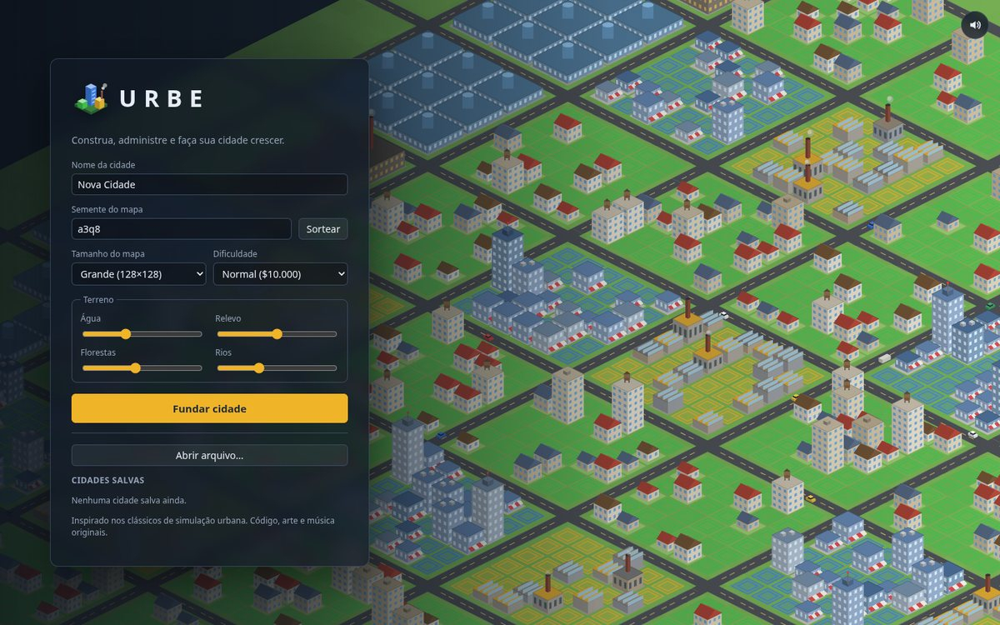
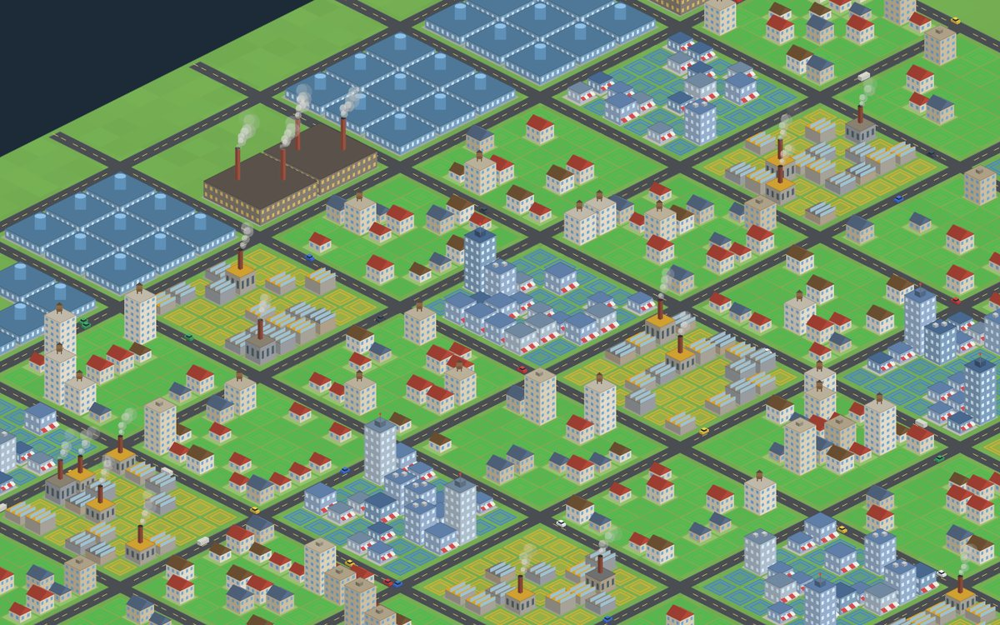

<p align="center">
  
</p>

<h1 align="center">Urbe</h1>

<p align="center"><strong>You set the conditions. The city decides the rest.</strong></p>

<p align="center">
  An isometric city builder that runs in the browser.
  Zone the land, connect power and water, keep the budget alive —
  then watch demand, traffic and disasters do the rest.
  No install. Interface in Brazilian Portuguese.
</p>

<p align="center">
  <a href="https://gamestudio42.github.io/urbe/">
    
  </a>
</p>

<p align="center">
  <a href="https://gamestudio42.github.io/urbe/">
    
  </a>
</p>

## Screenshots

<p align="center">
  
</p>

<p align="center">
  
</p>

<p align="center">
  <a href="https://gamestudio42.github.io/urbe/">
    
  </a>
</p>

## Why Urbe

- **Play in the browser.** Open the link and found a city. Nothing to download.
- **You create the conditions.** Roads, zones, plants and pumps. The simulator grows — or abandons — the lots.
- **A living city.** Cars follow traffic, chimneys smoke, water shimmers, fire engines roll out.
- **A mayor's desk.** Taxes, department funding, charts, thematic maps and a tile inspector that tells you *why* a lot is not growing.
- **Original soundtrack.** Calm lo-fi, synthesized on the fly — a slower piece in the menu, another in the city.
- **Your city stays with you.** Autosave in the browser, plus export and import of `.city.json` files.

## Play

| | |
| --- | --- |
| **Live game** | [gamestudio42.github.io/urbe](https://gamestudio42.github.io/urbe/) |
| **Hotkeys** | `R` road · `1–6` zones · `E` power · `T` water · `P` pause · `M` sound |
| **Language** | Interface in Brazilian Portuguese · code and docs in English |

## Develop

```sh
pnpm install
pnpm dev        # http://localhost:5173
```

Or with Docker: `docker compose up`.

| Command         | Description                                                 |
| --------------- | ----------------------------------------------------------- |
| `pnpm check`    | Lint, type check, unit/integration/scenario tests and build |
| `pnpm test:e2e` | Playwright end-to-end tests                                 |
| `pnpm sim`      | Headless simulation over presets and seeds                  |
| `pnpm bench`    | Tick timing benchmark (`--strict` for CI)                   |

Every push to `main` publishes `apps/web/dist` to GitHub Pages. To host it elsewhere:

```sh
BASE_PATH=/path/ pnpm build
```

Docs: [architecture](docs/architecture.md) · [simulation spec](docs/simulation-spec.md) · [balancing](docs/balancing.md) · [mechanics](docs/mechanics-matrix.md) · [roadmap](docs/roadmap.md) · [testing](docs/testing-strategy.md) · [agents](AGENTS.md)

## Licence

Original code, procedural sprites and synthesized sound and music, MIT licence.
Micropolis (GPLv3) and OpenSC2K were studied as references for behaviour only;
no code or assets were copied.
