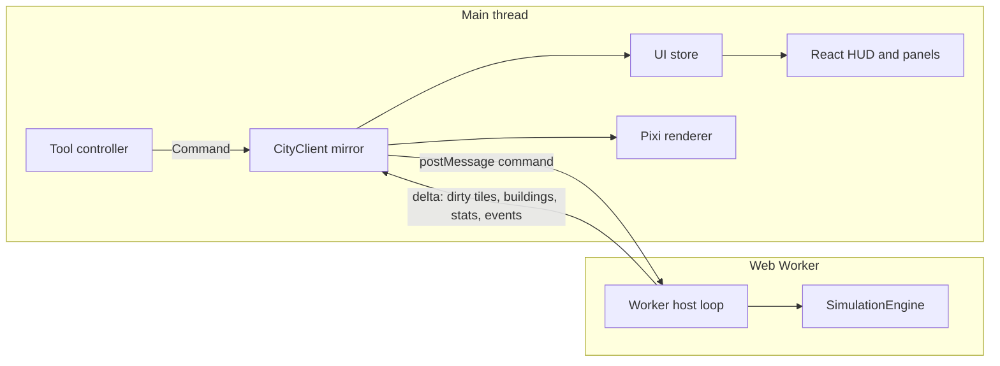

# Architecture

City Builder is a single-player, browser-based isometric city simulation. There is no
backend: the whole game runs on the client, and saves live in IndexedDB or in exported files.

## Packages

| Package               | Responsibility                                                         | May depend on      |
| --------------------- | ---------------------------------------------------------------------- | ------------------ |
| `packages/shared`     | Tile constants, command and message types, balance tables, save schema | nothing            |
| `packages/simulation` | Deterministic engine: world, systems, commands, persistence, scenarios | `@city/shared`     |
| `apps/web`            | Vite + React UI, PixiJS renderer, Web Worker host, IndexedDB saves     | shared, simulation |
| `tools/`              | Headless simulation reports and benchmarks (run with `tsx`)            | shared, simulation |
| `tests/`              | Unit, integration, scenario (Vitest) and end-to-end (Playwright) tests | everything         |

Packages expose their TypeScript sources directly (`"exports": "./src/index.ts"`). Vite, Vitest
and `tsx` compile them on the fly, so there is no package build step.

The simulation package compiles with `lib: ["ES2023"]` and no ambient types, so any accidental
use of DOM or Node APIs fails the type check. ESLint additionally bans `Math.random`, `Date`,
`performance` and the transcendental `Math` functions there (see [determinism](#determinism)).

## Runtime topology

- **SimulationEngine** (`packages/simulation/src/engine.ts`) owns the authoritative state. It is a
  plain class: `enqueue(command)`, `tick()`, `runTicks(n)`, `serialize()`, `Engine.fromSnapshot()`.
- **Worker host** (`apps/web/src/worker/sim.worker.ts`) runs a fixed-step loop. Real elapsed time is
  converted into a whole number of ticks according to the selected speed. The engine never
  sees wall-clock time.
- **CityClient** (`apps/web/src/state/client.ts`) keeps a read-only mirror `World` on the main
  thread. It applies the deltas sent by the worker. Because the mirror is a real `World`,
  the UI can run the same pure validation (`previewCommand`) and diagnostic
  (`diagnoseTile`) functions as the engine, without a round trip.
- **Renderer** (`apps/web/src/renderer`) draws the mirror. It never mutates simulation state.

## World representation

The map is a square grid (`size × size`, 128 by default) stored as a structure of arrays:

| Layer                                        | Type         | Meaning                                         |
| -------------------------------------------- | ------------ | ----------------------------------------------- |
| `heights`                                    | `Uint8Array` | Vertex heights, `(size + 1)²`, corners of tiles |
| `terrain`                                    | `Uint8Array` | `Terrain` enum (water, sand, grass, dirt, rock) |
| `trees`                                      | `Uint8Array` | Vegetation density 0..3                         |
| `zone`, `zoneDensity`                        | `Uint8Array` | Zone type and light/dense                       |
| `infra`                                      | `Uint8Array` | Bit flags: road, power line, water pipe, rubble |
| `buildingId`                                 | `Int32Array` | Building occupying the tile, `0` = none         |
| `powered`, `watered`                         | `Uint8Array` | Utility service flags                           |
| `fire`                                       | `Uint8Array` | Fire intensity, `0` = not burning               |
| `pollution`, `crime`, `landValue`            | `Uint8Array` | Influence maps, 0..255                          |
| `traffic`, `jobAccess`                       | `Uint8Array` | Aggregated traffic load and job accessibility   |
| `police`, `fireCover`, `health`, `education` | `Uint8Array` | Service coverage, 0..255                        |

Tile index: `i = y * size + x`. The `Tile` interface in `@city/shared` is only a read-only
view (`world.getTile(x, y)`), used by tests and the info panel.

Buildings are records in a `Map<number, Building>`. Insertion order is stable, so iteration is
deterministic. Zone buildings occupy one tile; placed buildings (plants, services) have a
footprint of `w × h` tiles.

## Simulation clock

| Unit  | Value               | Systems                                      |
| ----- | ------------------- | -------------------------------------------- |
| Tick  | 1/4 day             | Fires, active disasters, command application |
| Day   | 4 ticks             | Network rebuilds (power, water) when dirty   |
| Month | 30 days = 120 ticks | Influence maps, traffic, demand, growth, tax |
| Year  | 12 months           | Yearly statistics, evaluation                |

Speeds: paused, 1× (20 ticks/s, one month every 6 s), 2× and 4×. The worker accumulates
real time and runs a whole number of ticks per frame, capped to avoid a spiral of death.

## Tick pipeline

Each `tick()` runs, in order:

1. Apply queued commands (recorded with their tick number for replay).
2. Rebuild dirty networks (roads, power, water).
3. Recompute influence maps when the month changes.
4. Update demand, growth and occupancy (monthly).
5. Assign traffic and job accessibility (monthly, before growth reads it).
6. Collect taxes and pay expenses (monthly); yearly statistics.
7. Advance fires and disasters (every tick).
8. Publish: mark dirty tiles and buildings for the next delta.

Systems implement `System { id; update(ctx: SimContext): void }` and are registered in a fixed
order. The engine only orchestrates; game rules live in the systems.

## Determinism

- A single seeded RNG (`xoshiro128**`) with serializable state. No `Math.random`.
- No wall-clock time inside the engine.
- No transcendental `Math` functions in the engine (their precision is implementation-defined).
  Allowed: `+ - * /`, `Math.sqrt` (correctly rounded by IEEE 754), `floor`, `round`, `min`,
  `max`, `abs`, `imul`, `trunc`.
- Money is kept in whole dollars; fractional revenue is rounded once per month.
- Iteration order is always index order or insertion order.
- `hashState(engine)` (FNV-1a over every layer, building and economy field) is the oracle used by
  determinism and save/load tests.

## Persistence

`engine.serialize()` returns an `EngineSnapshot` (plain data, layers as `Uint8Array`).
`@city/shared` turns it into a versioned `SaveFile` (JSON, layers in base64, FNV checksum) and
validates it on load. Migrations are pure functions registered by version. The web app stores
saves in IndexedDB (`city-builder` database, `saves` store), autosaves periodically, and can
export or import `.city.json` files.

## Rendering

- Isometric projection: `screenX = (x - y) · w/2`, `screenY = (x + y) · h/2 - elevation · hₑ`,
  with `w = 64`, `h = 32`, `hₑ = 8` pixels.
- Terrain uses vertex heights, so slopes are drawn as quads with four independent corners.
- The map is split into 16×16 chunks. Each chunk owns a terrain `Graphics`, an overlay
  `Graphics` and an object container (building and tree sprites, depth-sorted by `x + y`).
  Chunks are ordered by `cx + cy`, so cross-chunk overlap is resolved back to front.
- Only chunks with dirty tiles are redrawn; off-screen chunks are culled.
- Building and tree textures are generated procedurally at startup from `Graphics` and cached.
- Picking inverts the projection for every candidate elevation and keeps the front-most tile
  whose quad contains the cursor.

## Error handling

- Rejected commands return a `RejectReason` code; the UI translates it to Portuguese.
- Save validation reports every problem found; a corrupted file never reaches the engine.
- IndexedDB quota errors and WebGL context loss are surfaced to the player.
