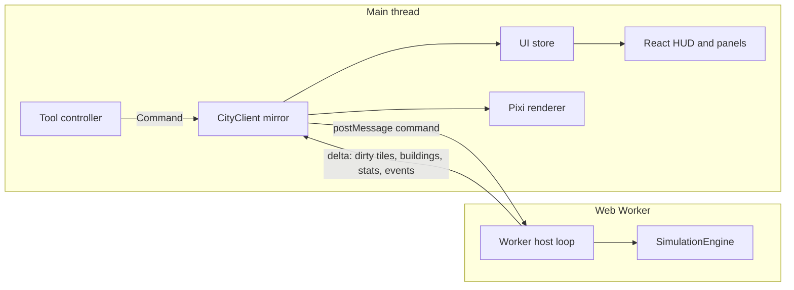

# Architecture

City Builder is a single-player, browser-based isometric city simulation. There is no
backend: the whole game runs on the client, and saves live in IndexedDB or in exported files.

## Packages

| Package               | Responsibility                                                         | May depend on      |
| --------------------- | ---------------------------------------------------------------------- | ------------------ |
| `packages/shared`     | Tile constants, command and message types, balance tables, save schema | nothing            |
| `packages/simulation` | Deterministic engine: world, systems, commands, persistence, scenarios | `@city/shared`     |
| `apps/web`            | Vite + React UI, PixiJS renderer, Web Worker host, IndexedDB saves     | shared, simulation |
| `tools/`              | Headless simulation reports and benchmarks (run with `tsx`)            | shared, simulation |
| `tests/`              | Unit, integration, scenario (Vitest) and end-to-end (Playwright) tests | everything         |

Packages expose their TypeScript sources directly (`"exports": "./src/index.ts"`). Vite, Vitest
and `tsx` compile them on the fly, so there is no package build step.

The simulation package compiles with `lib: ["ES2023"]` and no ambient types, so any accidental
use of DOM or Node APIs fails the type check. ESLint additionally bans `Math.random`, `Date`,
`performance` and the transcendental `Math` functions there (see [determinism](#determinism)).

## Runtime topology

- **SimulationEngine** (`packages/simulation/src/engine.ts`) owns the authoritative state. It is a
  plain class: `enqueue(command)`, `tick()`, `runTicks(n)`, `serialize()`, `Engine.fromSnapshot()`.
- **Worker host** (`apps/web/src/worker/sim.worker.ts`) runs a fixed-step loop. Real elapsed time is
  converted into a whole number of ticks according to the selected speed. The engine never
  sees wall-clock time.
- **CityClient** (`apps/web/src/state/client.ts`) keeps a read-only mirror `World` on the main
  thread. It applies the deltas sent by the worker. Because the mirror is a real `World`,
  the UI can run the same pure validation (`previewCommand`) and diagnostic
  (`diagnoseTile`) functions as the engine, without a round trip.
- **Renderer** (`apps/web/src/renderer`) draws the mirror. It never mutates simulation state.
- **GameSession** (`apps/web/src/state/session.ts`) wires the client, the renderer and the tools
  to a small `Store<UiState>`: current screen (menu or game), open panel, tutorial step, tool,
  overlay, speed and toasts. React components subscribe to slices of that store.

## User interface

| Element   | Component             | Notes                                                        |
| --------- | --------------------- | ------------------------------------------------------------ |
| Main menu | `ui/MainMenu.tsx`     | City name, seed, map size, difficulty, terrain sliders       |
| HUD       | `ui/Hud.tsx`          | Date, funds and monthly net, population, RCI bars, speeds    |
| Toolbar   | `ui/Toolbar.tsx`      | Tool groups with hotkeys and cost tooltips                   |
| Minimap   | `ui/Minimap.tsx`      | Isometric diamond, current overlay, view rectangle, recentre |
| Overlays  | `ui/OverlayPanel.tsx` | Twelve thematic maps with a legend                           |
| Budget    | `ui/BudgetPanel.tsx`  | Taxes, department funding, monthly ledger, debt warnings     |
| Charts    | `ui/ChartsPanel.tsx`  | Population, money, demand and environment history            |
| Inspector | `ui/Inspector.tsx`    | Tile facts and the "why is it (not) growing" problem list    |
| Tutorial  | `ui/Tutorial.tsx`     | Seven steps, auto-advanced by checks in `state/tutorial.ts`  |
| System    | `ui/SystemPanel.tsx`  | Saves, grid, underground view, sound, help, back to the menu |

Only one floating panel is open at a time; the inspector stacks above it in the right column.
`Esc` closes the panel first, then cancels the tool and clears the selection.

## World representation

The map is a square grid (`size × size`, 128 by default) stored as a structure of arrays:

| Layer                                        | Type         | Meaning                                         |
| -------------------------------------------- | ------------ | ----------------------------------------------- |
| `heights`                                    | `Uint8Array` | Vertex heights, `(size + 1)²`, corners of tiles |
| `terrain`                                    | `Uint8Array` | `Terrain` enum (water, sand, grass, dirt, rock) |
| `trees`                                      | `Uint8Array` | Vegetation density 0..3                         |
| `zone`, `zoneDensity`                        | `Uint8Array` | Zone type and light/dense                       |
| `infra`                                      | `Uint8Array` | Bit flags: road, power line, water pipe, rubble |
| `buildingId`                                 | `Int32Array` | Building occupying the tile, `0` = none         |
| `powered`, `watered`                         | `Uint8Array` | Utility service flags                           |
| `fire`                                       | `Uint8Array` | Fire intensity, `0` = not burning               |
| `pollution`, `crime`, `landValue`            | `Uint8Array` | Influence maps, 0..255                          |
| `traffic`, `jobAccess`                       | `Uint8Array` | Aggregated traffic load and job accessibility   |
| `police`, `fireCover`, `health`, `education` | `Uint8Array` | Service coverage, 0..255                        |

Tile index: `i = y * size + x`. The `Tile` interface in `@city/shared` is only a read-only
view (`world.getTile(x, y)`), used by tests and the info panel.

Buildings are records in a `Map<number, Building>`. Insertion order is stable, so iteration is
deterministic. Zone buildings occupy one tile; placed buildings (plants, services) have a
footprint of `w × h` tiles.

## Simulation clock

| Unit  | Value               | Systems                                                               |
| ----- | ------------------- | --------------------------------------------------------------------- |
| Tick  | 1/4 day             | Fires, active disasters, command application                          |
| Day   | 4 ticks             | Network rebuilds (power, water) when dirty                            |
| Month | 30 days = 120 ticks | Traffic, services, influence (last 3 ticks), then demand, growth, tax |
| Year  | 12 months           | Yearly statistics, evaluation                                         |

Speeds: paused, 1× (20 ticks/s, one month every 6 s), 2× and 4×. The worker accumulates
real time and runs a whole number of ticks per frame, capped to avoid a spiral of death.

## Tick pipeline

Each `step()` runs, in order:

1. Apply queued commands (recorded with their tick number for replay).
2. At the start of a day, rebuild the power and water networks if they are dirty.
3. Advance fires and disasters, then custom systems.
4. Advance the tick counter and run the month stage of the new tick, if any: traffic and job
   accessibility (tick 117 of the month), service coverage (118), influence maps (119), and the
   close (0) with demand, growth, budget, history, yearly events and random disasters.
5. Publish: the worker sends the dirty tiles and buildings as the next delta.

Spreading the month over four ticks bounds the worst tick by the heaviest stage instead of the
sum of all of them: on a 128×128 city with 32 000 residents the month costs about 28 ms in
total, and the p95 of every tick stays under 10 ms even on a CPU throttled to 400 MHz
(measurements in `docs/balancing.md`).

Systems implement `System { id; update(ctx: SimContext): void }` and are registered in a fixed
order. The engine only orchestrates; game rules live in the systems.

## Determinism

- A single seeded RNG (`xoshiro128**`) with serializable state. No `Math.random`.
- No wall-clock time inside the engine.
- No transcendental `Math` functions in the engine (their precision is implementation-defined).
  Allowed: `+ - * /`, `Math.sqrt` (correctly rounded by IEEE 754), `floor`, `round`, `min`,
  `max`, `abs`, `imul`, `trunc`.
- Money is kept in whole dollars; fractional revenue is rounded once per month.
- Iteration order is always index order or insertion order.
- `hashState(engine)` (FNV-1a over every layer, building and economy field) is the oracle used by
  determinism and save/load tests.

## Persistence

`engine.serialize()` returns an `EngineSnapshot` (plain data, layers as `Uint8Array`).
`@city/shared` turns it into a versioned `SaveFile` (JSON, layers in base64, FNV checksum) and
validates it on load (format in [the spec](simulation-spec.md#111-save-format)). Migrations are
pure functions registered by version.

Encoding and decoding run in the worker (`exportSave` / `importSave` messages), so a large
city never blocks the UI thread and an invalid file never replaces the running city.

The web app (`apps/web/src/persistence/saves.ts`) stores saves in IndexedDB, database
`city-builder`, with two stores keyed by slot id: `meta` (the small `SaveSlot` records listed
by the menu) and `data` (the save text). Each city has one manual slot (`city:<seed>:<name>`)
plus a shared `autosave` slot, written every minute of real time while the game screen is
open, when the tab is hidden and when the player goes back to the menu. Storage errors are
classified (`quota`, `unavailable`, `missing`) and shown to the player; export to a
`.city.json` file is always available as a fallback. Loaded cities start paused.

## Rendering

- Isometric projection: `screenX = (x - y) · w/2`, `screenY = (x + y) · h/2 - elevation · hₑ`,
  with `w = 64`, `h = 32`, `hₑ = 8` pixels.
- Terrain uses vertex heights, so slopes are drawn as quads with four independent corners.
- The map is split into 16×16 chunks. Each chunk owns a terrain `Graphics`, an overlay
  `Graphics` and an object container (building and tree sprites, depth-sorted by `x + y`).
  Chunks are ordered by `cx + cy`, so cross-chunk overlap is resolved back to front.
- Only chunks with dirty tiles are redrawn; off-screen chunks are culled.
- Building and tree textures are generated procedurally at startup from `Graphics` and cached.
- Picking inverts the projection for every candidate elevation and keeps the front-most tile
  whose quad contains the cursor.

## Audio

`apps/web/src/audio/sound.ts` synthesizes every sound effect with WebAudio (oscillators and a
noise buffer), so the project ships no audio files. `GameSession` plays a sound when a tool
command succeeds (build, zone, demolish), when one is rejected, and for selected engine events
(fire, destroyed building, disaster, brownout, water shortage, debt, bankruptcy, milestone).
The `AudioContext` is created lazily and resumed on the first pointer or key press, as
browsers require. Each sound is rate-limited to one play per 120 ms. Mute is toggled in the
system panel or with `M`, and is stored in `localStorage['cityBuilder.muted']`.

## Error handling

- Rejected commands return a `RejectReason` code; the UI translates it to Portuguese.
- Save validation reports every problem found; a corrupted file never reaches the engine.
- IndexedDB quota errors and WebGL context loss are surfaced to the player.
